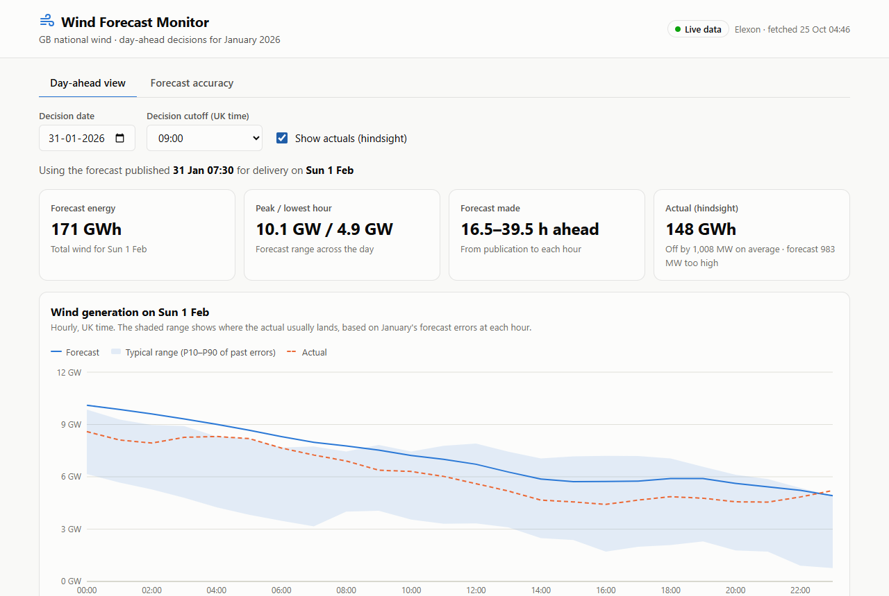
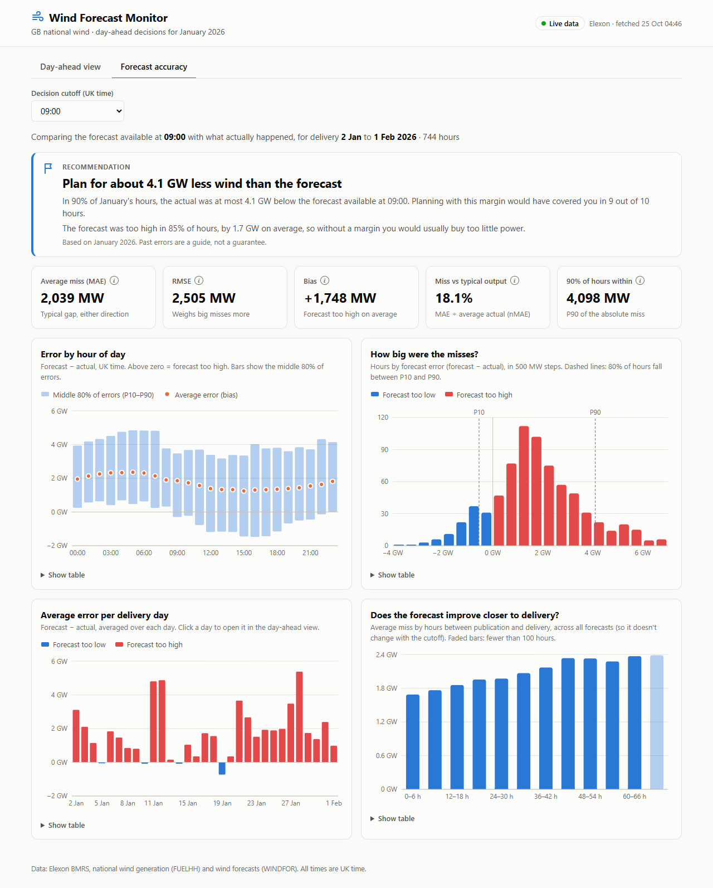
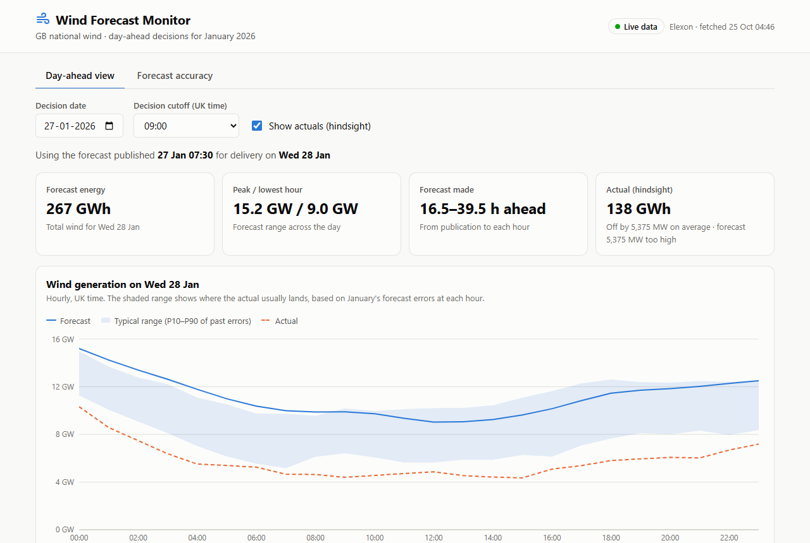

# Wind Forecast Monitor

[](https://github.com/itsvilram/qvtzrm/actions/workflows/ci.yml)

A web app for a GB energy supplier's day-ahead trading desk. It shows the **national wind forecast that was
available when each purchase decision had to be made**, and measures **how accurate those forecasts were**, so
traders can plan with a quantified margin of error.

**Live app: https://qvtzrm.vercel.app** · API docs: https://qvtzrm.vercel.app/api/docs



---

## What it shows

**Day-ahead view.** Pick a decision day in January 2026 and a decision cutoff (UK time). The app shows the latest
forecast published before that cutoff for every hour of the next day, the range the actual usually lands in, and
(optionally, "hindsight") what actually happened.

**Forecast accuracy.** Over all of January at the chosen cutoff: headline error figures, a recommendation for how
much margin to plan with, and error broken down by hour of day, by size, by delivery day and by how far ahead the
forecast was made. Clicking a day opens it in the day-ahead view.

| | |
|---|---|
|  |  |
| Forecast accuracy at the 09:00 cutoff | The worst day: 267 GWh forecast, 138 GWh actual |

### Headline results (January 2026, decisions at 09:00 UK time, 744 delivery hours)

| Figure | Value | In plain words |
|---|---|---|
| Average miss (MAE) | **2,039 MW** (18.1% of average output) | The day-ahead forecast is typically about 2 GW off |
| Bias | **+1,748 MW**; too high in **85%** of hours | It almost always expects more wind than turns up |
| Margin to plan with (P90 of error) | **4.1 GW** | Planning for 4.1 GW less wind than forecast would have covered 9 out of 10 hours |
| Lead time | 1.7 GW at 0–6 h ahead → 2.3 GW at 42–48 h | Forecasts improve closer to delivery |
| Later cutoff (12:00 instead of 09:00) | 2,039 → 1,901 MW | Waiting for the 11:30 forecast helps a little |
| Worst day | 28 Jan: 267 GWh forecast vs 138 GWh actual | Relying on the forecast would have left a ~5 GW shortfall all day |

The over-forecast grows with wind level (about +0.8 GW below 6 GW of forecast wind, +2.5 GW above 14 GW). A likely
cause is curtailment (wind farms paid to reduce output when the grid is constrained). **This is a hypothesis, not
confirmed** by this data.

---

## How it works

**Data** (the only sources used, as the brief requires): Elexon BMRS
[`FUELHH`](https://bmrs.elexon.co.uk/api-documentation/endpoint/datasets/FUELHH/stream) (actual generation,
`fuelType = WIND`, half-hourly) and
[`WINDFOR`](https://bmrs.elexon.co.uk/api-documentation/endpoint/datasets/WINDFOR/stream) (wind forecasts, hourly,
published about 8 times a day).

**The forecast-selection rule** ([`backend/app/forecasts.py`](backend/app/forecasts.py)). A decision on day D buys
power for delivery day D+1. For every target hour on D+1, the app takes **the latest forecast published at or
before the decision cutoff on D** (UK time). Forecasts published later did not exist when the decision was made;
using them would make the forecast look better than it was in practice.

- Default cutoff **09:00 UK time**: before both GB day-ahead auction gate closures (EPEX SPOT about 09:20, N2EX
  about 09:50). Other cutoffs (07:00–12:00) can be chosen in the UI.
- Actuals are half-hourly and forecasts hourly, so each hour's actual is the **average of its two half-hours**.
- **Error = forecast − actual.** Positive means the forecast was too high (risk of buying too little).

**Architecture**

```
Browser (React 19 + TypeScript, Recharts, TanStack Query)
   │  /api/* (JSON)
   ▼
FastAPI (Python 3.12) ── loads January once, keeps it in memory ──► Elexon API
   │                         (falls back to a saved snapshot if Elexon is unreachable)
   └─ pandas: pick decision-time forecasts → join actuals → error metrics
```

| Where | How it runs |
|---|---|
| **Vercel** (live) | `main.py` runs the FastAPI app as one serverless function; the built React app is served from Vercel's CDN. Uses the saved snapshot by default (fast cold starts; January's data no longer changes). |
| **Docker** (local) | Nginx serves the React app on port 8080 and forwards `/api` to the FastAPI container. Uses live Elexon data, falling back to the snapshot. |

**API**

| Endpoint | Returns |
|---|---|
| `GET /api/health` | `{"status": "ok"}` |
| `GET /api/meta` | Date range, default cutoff, publish times, data source and when it was fetched |
| `GET /api/day-ahead?decision_date=2026-01-15&cutoff=09:00` | Hourly forecast, actual, error and typical range for the delivery day, plus which forecast was used |
| `GET /api/accuracy?cutoff=09:00` | Summary metrics, recommendation, and breakdowns by hour, lead time, day and error size |

---

## How to start the application

### Option 1: Docker (recommended)

Requires Docker Desktop.

```bash
docker compose up --build
```

Open **http://localhost:8080** (API docs at http://localhost:8080/api/docs). First build takes about a minute.
For an offline demo using only the saved data: `DATA_SOURCE=snapshot docker compose up --build`.

### Option 2: Run backend and frontend directly

Requires Python 3.12+ and Node 24.

```bash
# Backend: http://localhost:8000/api/docs
cd backend
python -m venv .venv
.venv\Scripts\activate          # Windows (macOS/Linux: source .venv/bin/activate)
pip install -r requirements-dev.txt
uvicorn app.main:app --reload --port 8000
```

```bash
# Frontend: http://localhost:5173 (the dev server forwards /api to port 8000)
cd frontend
npm ci
npm run dev
```

### Run the tests and checks

```bash
cd backend  && ruff check . && ruff format --check . && pytest      # 78 tests
cd frontend && npm run lint && npm run format:check && npm test && npm run build   # 63 tests
```

Refresh the saved snapshot from Elexon: `cd backend && python -m app.snapshot`.
Independent spot check of API values against raw Elexon JSON: `cd backend && python -m scripts.spot_check`.

### Configuration (environment variables, all optional)

| Variable | Default | Purpose |
|---|---|---|
| `DATA_SOURCE` | `auto` (`snapshot` on Vercel) | `live`, `snapshot`, or `auto` (live, falling back to the snapshot) |
| `DEFAULT_CUTOFF` | `09:00` | Default decision cutoff (UK time) |
| `ELEXON_BASE_URL` | `https://data.elexon.co.uk/bmrs/api/v1` | Elexon API address |
| `CORS_ORIGINS` | `http://localhost:5173` | Allowed browser origins (only needed for the Vite dev server) |

---

## Files and directories

```
.
├── backend/                     FastAPI service (Python 3.12)
│   ├── app/
│   │   ├── main.py              App setup: CORS, 503 handler, docs at /api/docs
│   │   ├── routes.py            The four /api endpoints and input validation
│   │   ├── schemas.py           Response models (field names match the frontend types)
│   │   ├── config.py            Date ranges, cutoff, timezone, environment settings
│   │   ├── elexon.py            Elexon API client (timeouts, retries, UTC parsing)
│   │   ├── store.py             Loads the data once (live → snapshot fallback); caches analyses
│   │   ├── snapshot.py          Saved copy of January's data; `python -m app.snapshot` refreshes it
│   │   ├── actuals.py           Half-hourly actuals → hourly
│   │   ├── forecasts.py         Decision-time forecast selection (the core rule)
│   │   └── metrics.py           Error metrics, breakdowns, uncertainty band
│   ├── data/                    The snapshot: January actuals and forecasts (gzipped JSON, 100 KB)
│   ├── scripts/spot_check.py    Recomputes API values by hand from raw Elexon JSON
│   ├── tests/                   pytest suite (78 tests)
│   ├── Dockerfile               Production image (non-root, healthcheck)
│   ├── requirements.txt         Runtime packages (pinned); requirements-dev.txt adds pytest, ruff
│   └── pyproject.toml           ruff and pytest settings
├── frontend/                    React 19 + TypeScript + Vite
│   ├── src/
│   │   ├── api/                 Response types, fetch client, data-loading hooks
│   │   ├── pages/               Day-ahead view and forecast accuracy view
│   │   ├── components/          Charts, summary cards, controls, header/tabs, loading/error states
│   │   ├── lib/                 Number/date formatting, chart colours and styles
│   │   ├── state/               Tab, date and cutoff kept in the URL (shareable links)
│   │   ├── styles/global.css    Design tokens for light and dark mode
│   │   └── test/                Vitest + Testing Library suite (63 tests)
│   ├── Dockerfile, nginx.conf   Build with Node, serve with non-root Nginx; /api proxied to the backend
│   └── package.json             Scripts: dev, build, lint, format, test
├── docs/
│   ├── screenshots/             Screenshots used in this README
│   ├── PLAN.md                  Overall plan; BACKEND_PLAN.md and FRONTEND_PLAN.md have the design details
│   └── *_TASKS.md               Step-by-step build tasks with a review log for each
├── main.py                      Vercel entry point (backend + built frontend in one deployment)
├── requirements.txt             Python packages for Vercel (same pins as the backend; a test checks this)
├── vercel.json                  Vercel build command, bundle exclusions, cache and security headers
└── docker-compose.yml           Full stack locally on port 8080
```

---

## Quality and testing

Every push and pull request runs the checks below in GitHub Actions
([`.github/workflows/ci.yml`](.github/workflows/ci.yml)): backend lint, formatting and tests; frontend lint,
formatting, tests and type-checked build; and a build of both Docker images.

- **Backend:** 78 pytest tests cover the Elexon client (with a fake server), forecast selection (cutoff
  boundaries, late publishes, missing hours, UK summer time), metrics, data loading and fallback, and every API
  endpoint. `ruff` for lint and formatting.
- **Frontend:** 63 Vitest + Testing Library tests cover formatting, the API client and error messages, URL
  state, and both pages with a fake API. `oxlint` (warnings fail the check), Prettier, and a type-checked build.
- **Checked against real data:** forecast selection was compared with a row-by-row reimplementation (0
  mismatches at 4 cutoffs); `scripts/spot_check.py` recomputes values from raw Elexon JSON (3/3 exact).
- **Checked in a real browser** (Playwright, during development): the demo flow on Docker and on the live Vercel
  site (13/13 on-screen numbers match the API), accessibility with axe-core at phone, tablet and laptop widths in
  light and dark mode (0 WCAG 2.2 AA violations), and no console errors.
- **Charts:** colours validated for colour-blind separation and contrast; every chart has a legend, a tooltip,
  a screen-reader summary and a table view.

## Assumptions and limitations

1. Each hourly WINDFOR forecast is compared with the average of the two half-hourly FUELHH actuals in that hour.
2. A forecast published exactly at the cutoff counts as available.
3. Target hours with no forecast published before the cutoff are left out and reported (this only happens with
   cutoffs before about 02:30, which the UI does not offer).
4. The uncertainty band and the 4.1 GW margin use **all of January's** errors, including days after the decision
   being viewed. That suits a pilot review of the month; a production tool would use only past days.
5. "Error by hours ahead" uses **every** forecast, not just the one picked at the cutoff: with one fixed cutoff,
   each hour of day always has the same lead time, so that chart would only repeat "error by hour".
6. The bias finding (forecasts too high, more so in strong wind) is measured; its cause (likely curtailment) is
   not confirmed.

## Use of AI tools

This project was built with the help of **Claude Code** (Anthropic's AI coding assistant), which was used for
planning, writing code and tests, checking results against the real data, and writing documentation. The work was
done one task at a time, and each task was reviewed and approved before it was committed. The plans, task lists
and review logs are in [`docs/`](docs/).
